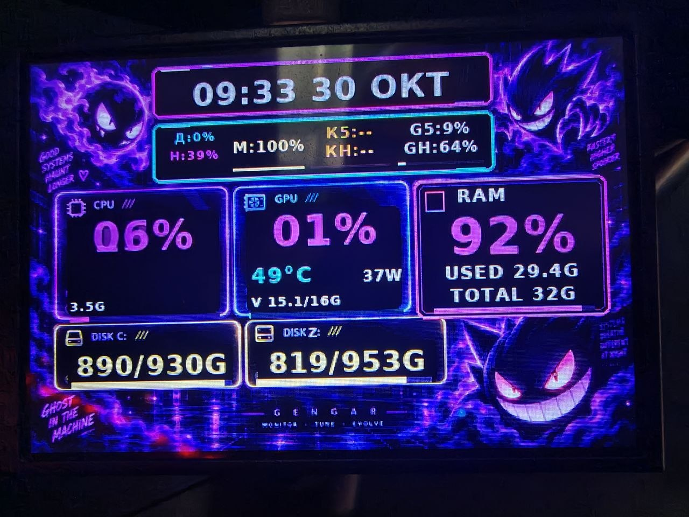
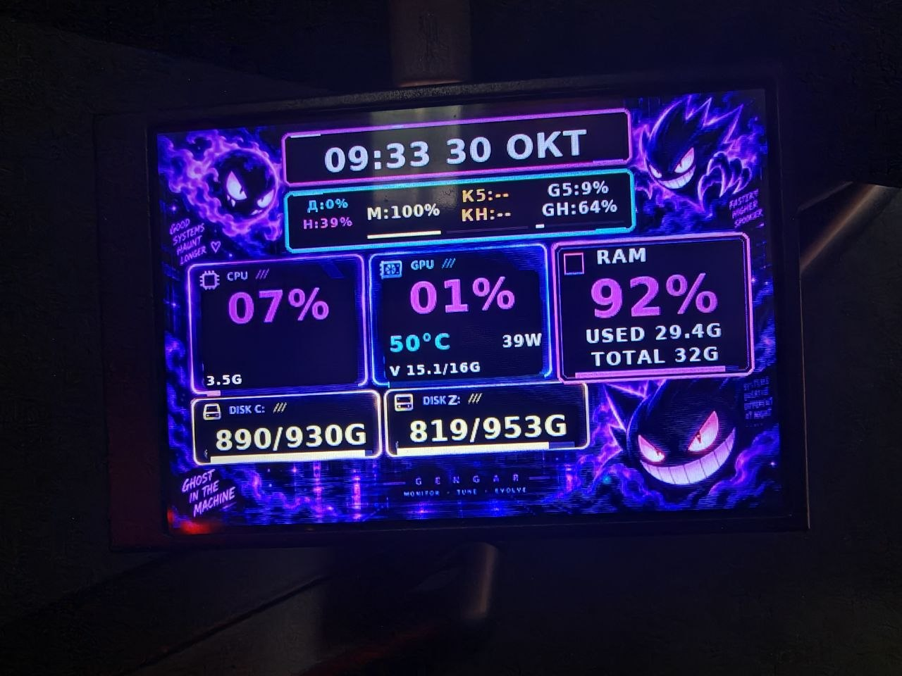

# Turing 3.5 Neon Monitor

Панель мониторинга для USB-дисплея Turing Smart Screen 3.5″ (480 × 320) на Windows. Показывает состояние ПК и лимиты OpenCode, Claude и Codex на неоновой теме.

| Панель вблизи | Дисплей |
|:---:|:---:|
|  |  |

## Возможности

- Часы и дата; CPU, GPU и RAM; заполнение дисков `C:` и `Z:`.
- Движущиеся неоновые блики и частичное обновление изменившихся областей экрана.
- OpenCode: `Д` — rolling/five-hour, `Н` — неделя, `М` — месяц. Шкала показывает месячное использование.
- Claude: оранжевые `К5` и `КН` — использованные проценты за пять часов и неделю.
- Codex: белые `G5` и `GН` — использованные проценты за пять часов и неделю.
- Шкалы под Claude и Codex показывают пятичасовое использование. `--` означает, что данные источника недоступны.
- Значок в системном трее и автозапуск при входе в Windows.

Показатели сервисов запрашиваются при запуске и затем каждые пять минут. Баланс OpenCode не запрашивается.

## Требования

- Windows 10/11 x64 и совместимый USB-дисплей 480 × 320.
- Go 1.23 или новее — только для сборки из исходников.
- Для данных NVIDIA используется `nvidia-smi`; доступность температуры и мощности CPU зависит от датчиков Windows или LibreHardwareMonitor.
- Подписи дисков `C:` и `Z:` заданы в `stable.go`. Если диска `Z:` нет, его показатели будут недоступны; для другого диска измените код и подпись темы.

## Запуск

1. Подключите экран и закройте другие программы, использующие его COM-порт.
2. Запустите `Turing35NeonStableV44.exe` или соберите его по инструкции ниже.
3. Значок программы появится в системном трее. Обычный запуск добавляет программу в автозапуск текущего пользователя Windows.

Приложение ищет устройство `VID_1A86&PID_5722`; если оно не найдено, используется `COM5`. Порт можно указать вручную перед запуском:

```powershell
$env:TURING_COM = 'COM5'
.\Turing35NeonStableV44.exe
```

Для просмотра макета без подключения дисплея:

```powershell
.\Turing35NeonStableV44.exe --preview
```

Файл `neon_preview.png` появится рядом с EXE. При обычном запуске журнал `app_neon.log` также создаётся рядом с EXE.

## Сборка и проверка

Откройте PowerShell в папке проекта:

```powershell
go test -v ./...
go vet ./...
.\build.ps1
```

Либо выполните сборку вручную:

```powershell
go build -ldflags '-H=windowsgui -s -w' -o Turing35NeonStableV44.exe .
```

Тесты и сборка рассчитаны на Windows. Готовый EXE в локальной папке исключён из Git через `.gitignore`; для распространения его можно приложить к GitHub Release.

## Подключение лимитов

### OpenCode

Используется ключ провайдера `opencode-go` из `~/.local/share/opencode/auth.json` или `%APPDATA%\opencode\auth.json`. Можно также задать переменную `OPENCODE_API_KEY`. Если rolling-данные недоступны, блок OpenCode не выводится; при отсутствии в ответе недельного или месячного поля текущая версия подставляет `0`.

### Claude

Установите [Claude Code](https://code.claude.com/) и войдите в подписку Claude:

```powershell
claude auth login --claudeai
```

Программа читает действующий локальный токен Claude Code и не обновляет его самостоятельно. Если вход истёк, показатели будут `--`; повторите вход. Источник статистики Claude использует недокументированный endpoint, который может измениться.

### Codex

Установите [Codex](https://developers.openai.com/codex/) и войдите с ChatGPT. Приложение использует локальный `codex app-server` и его метод `account/rateLimits/read`. Проверяются окна именно на 300 и 10080 минут; отсутствующее окно отображается как `--`.

## Если экран остановился

Проверьте `app_neon.log` рядом с программой. При ошибках COM убедитесь, что экран не занят другим приложением; если Windows сообщает, что устройство не функционирует, переподключите его по USB. Программа периодически повторяет подключение. Если `--` отображается у Claude или Codex, проверьте вход в соответствующий клиент и подождите следующий опрос.

## Структура

```text
stable.go          дисплей, датчики, рендер и системный трей
usage_limits.go    получение лимитов Claude и Codex
stable_test.go     тесты рендера, протокола и лимитов
assets/            встроенный фон, иконка и растровые шрифты
build.ps1          сборка EXE для Windows
.github/workflows/ тест и сборка в GitHub Actions
```

`gen_fonts.py` и `prepare_base.py` — вспомогательные скрипты для работы с графикой; они не нужны для обычной сборки.

## Лицензия

См. [LICENSE](LICENSE).
